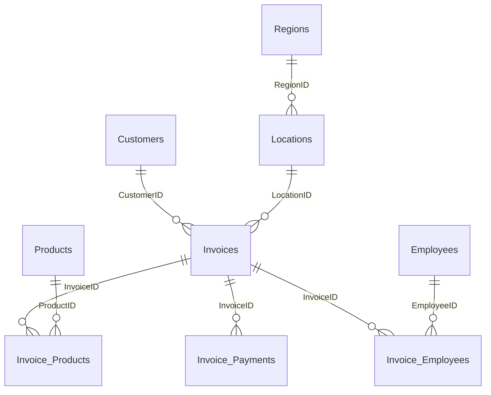
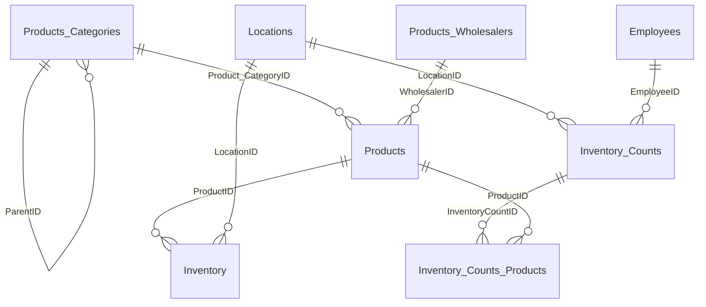
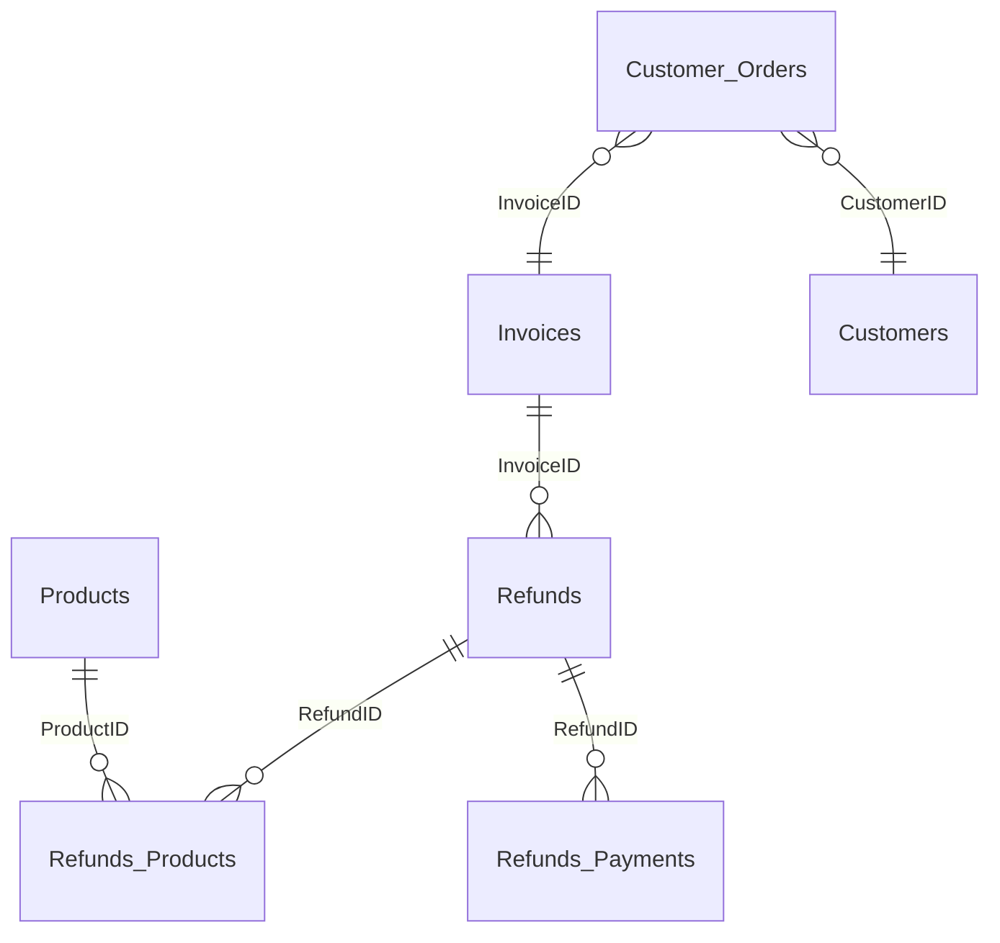
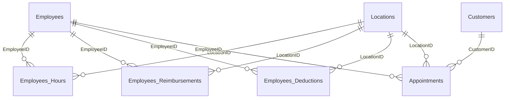

# Nova POS Table Relationship Map

AgentChat/coding_agent 2026-07-09

This is the agent-facing map for Nova Classic `POS_<Company_Username__c>`
databases. Use it as the first mental model, then confirm the current account
with `schema/pos_relationship_discovery.sql` because older accounts can drift
and many Nova tables do not always have declared SQL foreign keys.

## Safe Workflow

1. Resolve the Salesforce account to `Account.Company_Username__c`.
2. Connect to `POS_<Company_Username__c>` with read-only intent.
3. Run `schema/pos_schema_preflight.sql`.
4. Run `schema/pos_relationship_discovery.sql`.
5. Use the narrowest report script in `reports/`.
6. Alex and Jamie produce read-only evidence and an exact repair mapping, then
   route every UPDATE, INSERT, temporary-table, or schema-migration request to
   Taylor.
7. Taylor alone calls `nova_sql_write_preview` and
   `nova_sql_execute_guarded`. The guarded broker fully backs up every permanent
   target, requires exact row counts/readback, and rejects DELETE, DROP,
   TRUNCATE, arbitrary ALTER, MERGE, unbounded UPDATE, and direct/native SQL
   writes. The sole ALTER exception is Taylor's fixed, no-SQL-input
   `nova_sql_locations_feature_columns_preview` then
   `nova_sql_locations_feature_columns_execute` workflow for the five approved
   nullable `dbo.Locations` columns.

## Core Sales Shape

Use `Invoices` as the sale header. Most invoice investigations need all three
detail tables:

- `Invoice_Products`: products, quantity, sale price, discount, tax.
- `Invoice_Payments`: payment method, details, amount, tender/change fields
  when present.
- `Invoice_Employees`: commission attribution and commission timestamp.

`Invoices.CustomerID` is the customer attached to the sale. If a Nova invoice
opens blank, check the header row first, then products/payments/employees,
because the UI often renders as empty when a required detail relationship is
missing or malformed.

## Product And Inventory Shape

Important product notes:

- `Products_Categories.ParentID` is the parent category link. Nova category
  behavior can be shallow in the UI, so do not assume child categories are
  included unless the query explicitly includes `ParentID`.
- `Inventory` is the location-specific stock table. Inventory performance
  checks usually start with `Inventory.LocationID`, `Inventory.ProductID`, and
  inventory history tables when present.
- `Products.ProductIsAvailable` hides/deactivates products without removing
  historical invoice rows.

## Refund And Layaway Shape

Refund and layaway tables vary more by account/version, so confirm with
`schema/pos_relationship_discovery.sql` before writing a repair. The common
shape is:

For layaway refunds, preserve the business rule from the ticket. Sometimes the
customer order total must stay unchanged while only payments/commission/refund
records are adjusted. Do not assume `Customer_Orders` should be updated.

## Employee, Salary, And Appointment Shape

For commission and salary support, keep Nova's base behavior centered on
`Invoice_Employees.AmountForComission` and
`Invoice_Employees.AmountForComissionTimestamp`, then add hours,
reimbursements, and deductions only after verifying the date window.

## Common Support Diagnostics

- Blank invoice in Nova:
  Run `reports/core_integrity_audit.sql` for the target date/invoice window.
  Look for missing `Invoice_Payments.PaymentMethod`, missing
  `Invoice_Payments.PaymentDetails`, orphan detail rows, or missing invoice
  header values.
- Customer export:
  Start from `Customers`, left join latest `Invoices` by `CustomerID`, and do
  not export keys, logs, tokens, or integration secrets unless specifically
  authorized.
- Product not appearing on sale screen:
  Check `Products.ProductIsAvailable`, category, inventory rows for the
  selected location, and quantity/minimum fields.
- Inventory reports slow:
  Confirm table row counts and index coverage with
  `schema/pos_relationship_discovery.sql`, then inspect the specific report
  predicate before proposing index maintenance.
- Layaway payment/refund mismatch:
  Compare invoice header, invoice payments, invoice employees, refund header,
  refund payments, and customer order records separately. Do not merge them
  into one number search.

## Relationship Maintenance Rules

- Treat this map as a practical support model, not a guarantee that every
  relationship is declared as a SQL foreign key.
- When a ticket reveals a new table pattern, update this file and add the
  relationship to `schema/pos_relationship_discovery.sql`.
- Never add customer names, connection strings, passwords, tokens, or exported
  private rows to this map.
