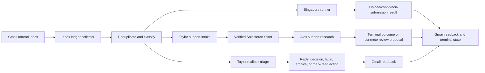
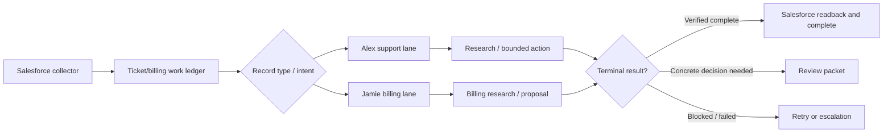

# Command Center Full QA Report

**Audit date:** 2026-07-17 13:41 ET
**Environment:** live local Command Center at `http://127.0.0.1:17866/dashboard/`
**Repository state:** branch `codex/live-runtime-wip-20260713`, commit `6b1b90a`, with substantial uncommitted operator work in progress
**Audit type:** read-only functional, workflow, role/permission, security, visual, responsive, accessibility, runtime, and test review

## Executive verdict

The Command Center is **operational and visually strong on a large desktop**, and its typed SQL, Rescue, Gmail-send, and review/readback controls show thoughtful safety work. It is not yet production-hardened for the sensitivity and authority it currently holds.

The release recommendation is **conditional hold for unattended or broadly trusted use** until the four highest-risk controls are addressed:

1. authenticate the local API and reject unauthenticated/no-origin/null-origin mutations;
2. remove shared read/modify access to secrets, signing keys, tokens, and connector environment files;
3. enforce agent boundaries at the OS/credential/tool layer instead of through prompts and shared-process policy alone;
4. split Salesforce mutations by lane and business domain.

The live UI can continue to be used by the intended operator on this computer with care, but it should be treated as a **single-user privileged administration console**, not as an isolated multi-agent security boundary.

### Scorecard

| Area | Rating | Verdict |
|---|---:|---|
| Runtime availability | B+ | Healthy process, loopback binding, three workers, durable ledgers, no browser console errors |
| Email workflow | C | Good dedupe/readback concepts; terminal-state backlog and SLA/priority handling are not trustworthy yet |
| Ticket workflow | B- | Clear support/billing routing and live Salesforce refresh; saga, acceptance, escalation, and review semantics remain incomplete |
| Agent ownership | B | Official RACI is clear and materially improved |
| Permission enforcement | D+ | Shared full-access OS identity and cross-lane tools defeat the intended department boundaries |
| Security/privacy | D+ | Local-only reduces remote exposure, but the API is unauthenticated and exposes sensitive data and live actions |
| Desktop visual design | B+ | Polished, coherent, and information-rich at wide desktop widths |
| Responsive/mobile design | D | Compact widths hide details; phone layout is functionally unusable |
| Accessibility | C- | Good semantic structure in places, but hidden Spotify content leaves 119 focusable controls in the tab order |
| Automated verification | A- | 710 repository tests passed; focused safety/workflow suite passed; one connector suite lacks its test dependency |

## Scope and method

The audit combined:

- direct inspection of the live dashboard across Kanban, Emails, Analytics, Activity, Drawing Board, Voice Room, and Alex Chat;
- responsive checks at wide desktop, 1440×900, 1024×768, and 390×844 targets;
- DOM, focusability, overflow, console, and accessibility-tree inspection;
- anonymous read-only requests to live Command Center endpoints;
- runtime health, job, inbox-ledger, Salesforce-ledger, email, ticket, review, KPI, and voice status inspection;
- code/config review of routes, origin checks, agent policy, child-process environments, break-glass controls, inbox/ticket ledgers, scoped MCP servers, and ownership documentation;
- Windows ACL review without reading secret values;
- full and focused test execution and dependency auditing.

No email was sent, ticket was changed, review was resolved, task was dismissed, voice session was joined, or other live mutation was performed.

## Live state observed

At the final runtime snapshot:

- service health was green, bound to loopback, with `max_workers=3`, not paused or degraded;
- one Alex background job was running and no jobs were queued;
- inbox ledger integrity reported `ok`, with 113 `action_pending` and 693 complete records;
- inbox polling was healthy and fast (approximately 327 ms for the latest no-op poll), but reported detection-latency p95 was 706,569,000 ms, approximately 8.18 days;
- Salesforce ledger integrity reported `ok`, with 99 completed ticket items and 390 completed billing items;
- the current Salesforce board refresh showed 12 open tickets: 11 support, 1 billing, and 9 stale for three or more days;
- Email Watch showed 6 messages needing reply or decision;
- one review packet remained open;
- local voice was ready, local-only, GPU-backed with CPU fallback, and network fallback disabled;
- OpenAI Realtime voice was configured in the UI but not ready because no API key was present; external writes were disabled.

The runtime health endpoint is useful, but its green state does not currently incorporate aged `action_pending` work, SLA violations, or the extreme detection-latency metric. “Healthy” therefore means the process and collectors are running, not that all business obligations are healthy.

## Process maps and QA conclusions

### Email process

What aligns:

- one ledger collector is the active ingestion owner while the ledger is available;
- message dedupe, route assignment, assigned job IDs, write readback, and terminal states are modeled explicitly;
- legacy support/email watchers are suppressed when the ledger is active;
- reply sending is locked to the Gmail thread, preserves the native signature, and requires an explicit operator verification checkbox;
- the support flow requires Salesforce/Gmail readback before claiming completion;
- Singapore work has deterministic per-message result categories rather than routing routine operations into tickets.

Observed gaps:

1. **Terminal-state backlog is not trustworthy.** Of 113 nonterminal records inspected, 107 were assigned to the Singapore route. Only one was still unread; 106 were already read in Gmail but remained `action_pending`, without verified write readback. The remaining six Taylor items included very old messages. This is a lifecycle/data-reconciliation defect, not merely an inbox count.
2. **Health does not fail or warn on aged obligations.** Integrity remains green even with action-pending items aged many days and a p95 detection metric over eight days.
3. **Priority and deadline handling are unsafe.** All six Email Watch items were labeled normal, including past-due notices and dispute notices whose displayed deadlines had already passed. One recommendation still said “deadline today” for a July 1 message on July 17.
4. **Relative deadline text is persisted instead of recomputed.** Operator guidance can become false as the cache ages.
5. **Reply affordances are too broad.** Workday task notifications, internal notices, and likely no-reply messages receive the same large reply composer as customer threads. The final send is gated, but the UI encourages an irrelevant workflow.
6. **`SCAN` understates side effects.** The scan workflow can produce mailbox writes, but its label does not disclose that behavior.
7. **Fail-open rollback can re-enable legacy writers.** If ledger initialization fails and `ops_inbox_ledger_fail_open_to_legacy` remains true, legacy watchers resume. That is useful for continuity but reintroduces duplicate-writer risk unless mutual exclusion and idempotency are independently proven.
8. **The source-acknowledgement boundary is not fully durable.** The official gap register still records that support mail may be acknowledged before the downstream Alex obligation reaches a terminal disposition.

Email verdict: the architecture is directionally correct, but business-completion health, SLA calculation, and terminal reconciliation must be repaired before the inbox ledger can be treated as authoritative.

### Ticket process

What aligns:

- ticket and billing records have durable classification and completion states;
- support routes to Alex and billing routes to Jamie;
- closed tickets can reconcile and clear review obligations only after live Salesforce evidence;
- ticket creation/update/email clients have bounded fields, fixed object paths, duplicate checks, and readback;
- Nova SQL writes are reserved for Taylor and use preview hashes, backups, row-count checks, readback, and destructive-query rejection;
- the board explicitly shows stale-ticket counts and review state.

Observed gaps:

1. **No durable cross-system parent saga.** Email, ticket, agent job, review, outbound message, and final source acknowledgement are separate records without one authoritative parent state and resource lock.
2. **No shared resource-level execution coordinator.** Two surfaces can still act on the same Gmail thread, Salesforce ticket, subscription, or repository through different queues.
3. **Handoff acceptance is incomplete.** Propelr/NMI and support intake can create a ticket without a durable accepted-at/terminal-ownership checkpoint from Alex.
4. **Escalation fields are incomplete.** Review/handoff records lack consistent due date, severity, accepted-at timestamp, escalation owner, and SLA breach state.
5. **Review semantics are unclear to operators.** The inspected packet said a requested correction was completed and verified but remained blocked/needs review after a rejected closure. Buttons offered Continue/Resolve/Abandon without enough explanation of what each action would change.
6. **Board freshness is too slow for operations.** The configured 15-minute refresh was observed around 20–22 minutes stale before a new background refresh completed.
7. **Ticket details are hard to read.** Technical notes contained duplicated update blocks, did not wrap well, and required horizontal scrolling.
8. **Compact layouts remove the detail panel.** At approximately 1024 px and below, the selected-ticket panel disappears without a confirmed alternative detail view.

Ticket verdict: the core routing and guarded-write controls are solid, but ownership transfer, same-resource locking, review semantics, and operator freshness need work.

## Agent scope and permission alignment

| Agent | Intended scope | What is correctly enforced | Material misalignment |
|---|---|---|---|
| General Operator / Direct Codex | Intake, classification, coordination, ordinary machine/repository work | Positive MCP allowlist; trusted-request check; no generic Salesforce MCP | Runs full-access in `C:/Users/redma`; same OS identity can read local credentials and invoke unauthenticated Command Center actions outside the MCP contract |
| Raw Codex | Incident-only unscaffolded break-glass | Operator authority, `BREAK_GLASS <incident-id>`, no MCP, ephemeral session, no persistent memory | No enforced approver identity, reason, expiry, credential scope, independent readback, or post-use credential purge; still full OS access |
| Taylor / Engineering | Runtime, queues, repositories, Gmail operations, Singapore, cloud/Zoom admin, sole SQL mutation executor | SQL writes are uniquely exposed here and strongly guarded; Rescue disabled; positive MCP allowlist | Role is overloaded; trusted child receives inherited environment; full-access workspace spans all repos; Salesforce proxy also exposes support/billing mutations |
| Claude / QA | Alternate implementation, independent review, verification | No configured provider MCP and ephemeral CLI session | Full filesystem access, `acceptEdits`, broad workspace, and trusted inherited environment contradict “no provider credentials”; prompt text is not credential isolation |
| Alex / Support | Support tickets, Salesforce/Nova investigation, Rescue, explicit new-interface tickets | Rescue is scoped read-only; SQL mutation is absent; ticket routing and support profile align | Same Salesforce mutation set as Jamie/Taylor includes ticket creation/resolution, order creation, location updates, and customer email; no hard support-record-type restriction |
| Jamie / Billing | Billing, subscriptions, refunds, tax evidence, billing tickets | SQL mutation absent; billing work ledger routes correctly | Same Salesforce mutation set as Alex/Taylor includes support-ticket and non-billing writes; same-user local credentials can bypass the intended Maxio/Salesforce domain boundary |

### Permission findings

The capability contract is a useful routing and prompt contract, but it is not a hard security boundary:

- all six lanes are configured `danger-full-access`;
- trusted child processes inherit nearly the full parent environment, except a limited non-exportable-service scrub;
- all lanes run as the same Windows user and can reach local files and native command-line clients;
- positive MCP allowlists only constrain which MCP servers are launched; they do not constrain shell, filesystem, native clients, or the local Command Center HTTP API;
- the scoped Salesforce server varies SQL-write exposure for Taylor, but exposes the same Salesforce mutation tools to all three lanes;
- the Windows `CodexSandboxUsers` group had read-and-execute access to the repository `.env`, the operator-message signing key, Gmail token, Codex config, and inbox ledger;
- that group had **Modify** access to the LogMeIn connector `.env`, creating both credential-confidentiality and configuration-integrity risk.

This means a compromised or misrouted agent can bypass the documented ownership model without using a forbidden MCP tool.

## Security and privacy findings

### Priority 0 / High

#### SEC-01 — Local control API has no authentication or CSRF token

The only general request checks are “client is loopback” and “Origin, if present, is loopback or null.” Requests without an Origin are accepted. `Origin: null` is explicitly allowed. The server returns `Access-Control-Allow-Origin: null` for no-origin responses.

Anonymous local endpoints expose jobs, prompts, results, runtime state, memory/task data, email state, tickets, review packets, and chat transcripts. Anonymous POST endpoints can pause/resume the runtime, dispatch agent work, send replies, mark mail read, trigger scans, manipulate review packets, control Spotify, and create/update/dispatch drawing-board tasks.

A read-only proof retrieved `/jobs` without credentials: HTTP 200, `Access-Control-Allow-Origin: null`, approximately 270 KB of response data. No mutation was attempted.

**Risk:** any process running as the user, and potentially a malicious local HTML file with a null origin, can read sensitive operational/customer data or initiate trusted actions.

**Required control:** issue a random per-launch bearer/session token, bind it to the dashboard session, require it for every API call, add anti-CSRF validation, reject null origins, reject no-origin browser mutations, use `Cache-Control: no-store` on sensitive responses, and split read-only from mutation authority.

#### SEC-02 — Secret and signing material is readable or modifiable across sandbox users

ACL inspection found inherited `CodexSandboxUsers` read access on the main `.env`, operator signing key, Gmail token, Codex config, and inbox ledger; the connector `.env` was modifiable.

**Risk:** agent compromise can disclose credentials, forge trusted internal messages, alter connector configuration, or corrupt audit/business state.

**Required control:** store secrets outside shared workspaces; remove inherited sandbox-group access; run each privileged connector under a dedicated service identity; make signing keys user/service-only and non-modifiable by agent workers; rotate credentials after the ACL change.

#### SEC-03 — Agent isolation is advisory, not technical

Full sandbox access, shared Windows identity, broad workspace roots, and trusted environment inheritance allow agents to bypass MCP and prompt restrictions.

**Required control:** separate worker identities or containers, per-agent credential stores, per-agent filesystem roots, a deny-by-default egress policy, and a broker that issues short-lived operation-specific credentials.

#### SEC-04 — Salesforce business-domain separation is not enforced

Alex, Jamie, and Taylor receive the same Salesforce mutation capabilities: create/update/resolve tickets, update internal notes, create orders, update locations, and send ticket email. Only SQL write exposure changes by lane.

**Required control:** publish distinct MCP tool sets and server-side policy for support, billing, and engineering; enforce record type, allowed object, allowed fields, permitted state transitions, financial thresholds, and customer-communication authority at execution time.

### Priority 1 / Medium-High

#### SEC-05 — Activity and chat surfaces overexpose operational data

The Activity view showed raw operator prompts, results, and local file paths. Alex Chat history included customer/system identifiers, database names, record IDs, internal paths, and backup details. Password/API-key values were correctly withheld, but the remaining data is still sensitive.

**Required control:** role-filter transcripts, redact customer/internal identifiers by default, add retention limits, provide a privileged reveal action, and never serve full prompts/results from an unauthenticated endpoint.

#### SEC-06 — Break-glass governance is incomplete

Raw Codex now requires trusted operator authority and an incident marker and is ephemeral, which is a meaningful improvement. It still lacks time-bound approval, explicit credential scope, independent verifier assignment, audit closeout, and post-use purge/rotation.

#### SEC-07 — Sensitive responses are cacheable by default

Most JSON responses do not set `Cache-Control: no-store`. Browser/proxy caches can retain prompts, customer data, and job results.

#### SEC-08 — Fail-open email fallback expands the duplicate-writer surface

When the inbox ledger is unavailable, legacy mailbox watchers can resume. This should be a deliberate degraded mode with a single elected writer, visible alert, and idempotency proof rather than an automatic silent fail-open.

## Design, responsive, and accessibility findings

Evidence captures:

- [Desktop 1440×900](../tmp/command-center-qa-20260717/desktop-1440x900.png)
- [Compact 1024×768](../tmp/command-center-qa-20260717/compact-1024x768.png)
- [Mobile 390×844](../tmp/command-center-qa-20260717/mobile-390x844.png)

### What works well

- coherent dark visual system, strong hierarchy, consistent colors, and useful operational status cues;
- clear main navigation, agent status, source/freshness language, and prominent stale/review counts;
- wide-desktop Kanban makes support, billing, and review lanes understandable;
- Analytics openly labels its snapshot partial and surfaces upstream count/time contradictions instead of hiding them;
- Email send guard communicates locked thread, verification, signature preservation, and readback;
- Voice Room defaults to mic off and clearly states local-only privacy with network fallback disabled;
- browser console inspection found no errors or warnings;
- reduced-motion CSS is present.

### Priority visual/UX issues

| ID | Severity | Finding | Recommendation |
|---|---:|---|---|
| UX-01 | High | At 390×844, the internal workbench remains about 760 px wide while the page hides horizontal overflow. Much of the board is unreachable. | Implement a true mobile mode: stacked lane selector, ticket list/detail navigation, responsive rail, and no clipped overflow. If mobile is unsupported, show an explicit desktop-only gate instead of a broken view. |
| UX-02 | High | Hidden Spotify panel has `aria-hidden=true` and opacity 0, but retains 119 enabled focusable descendants. | Apply `inert`/`hidden`, remove descendants from tab order, and restore focus to the opener on close. Add keyboard traversal tests. |
| UX-03 | Medium-High | At approximately 1024 px, the ticket detail panel is removed with no visible substitute; office and nav content are heavily clipped. | Replace the panel with a modal/drawer detail route and a scrollable or collapsed nav. |
| UX-04 | Medium | Email cards are dense, use oversized empty textareas, and show reply controls for likely no-reply/task notifications. | Classify action type first; render reply only for reply-eligible threads; use compact progressive disclosure. |
| UX-05 | Medium | Urgency is visually understated: passed deadlines and past-due notices still appear “normal.” | Add computed age/SLA/due badges, overdue styling, owner, and sortable priority. |
| UX-06 | Medium | Technical notes duplicate blocks, do not wrap cleanly, and create horizontal scrolling. | Normalize/dedupe notes server-side and use wrapped structured timeline entries. |
| UX-07 | Medium | Selected-ticket detail persists in unrelated views, exposing sensitive context and reducing usable width. | Scope detail to ticket views or collapse it by default outside Kanban. |
| UX-08 | Medium | Alex Chat is narrow relative to long transcripts and does not show the agent’s enforced capabilities or current authorization context. | Use a wider resizable panel and display “can/cannot do,” current lane, write approval, and data-source badges. |
| UX-09 | Low-Medium | Voice copy says “Press Join,” but the Voice Room has no Join button; calling is initiated elsewhere. | Align copy and control location; provide one clear primary action. |
| UX-10 | Low-Medium | The office illustration consumes space at wide sizes and collapses into a nearly decorative strip at compact sizes. | Make it collapsible and prioritize actionable queues at operational widths. |

## Data quality and observability

The Analytics page correctly identifies that the source spreadsheet is not decision-grade for the displayed period:

- 19 total tickets conflicts with 12 closed plus 9 unresolved (21);
- session work time is 32:26:26 in one summary and 08:26:26 in another;
- visible KPI tables were last refreshed July 14 while the audit occurred July 17.

This is an upstream reporting/data-contract issue, not a concealed UI defect. The Command Center should continue displaying the warnings, and should add a hard “not reconciled” banner before these figures are used for staffing or performance decisions.

Operational telemetry gaps:

- green process health does not account for aged business obligations;
- detection-latency p95 is polluted or genuinely severe and lacks a visible explanation;
- job history includes blocked, cancelled, failed, interrupted, recovery-review, and completed-with-issues states, but the dashboard does not provide a concise reliability trend or failure-rate denominator;
- `/jobs` returns a large response with full historical details instead of paginated, minimized summaries;
- watcher failure-age and repeated-failure escalation thresholds remain incomplete.

## Verification results

| Check | Result |
|---|---|
| Full repository test suite | **710 passed** in 39.26 seconds |
| Focused Command Center/security/ledger/review suite | **287 passed** in 13.58 seconds; included in the full-suite total |
| Python dependency consistency | `pip check`: no broken requirements |
| Declared main requirements vulnerability scan | `pip-audit`: no known vulnerabilities found |
| Scoped operations MCP suite | Could not collect because the current main runtime lacks the `mcp` test dependency; treat as a CI/environment coverage gap, not a failed product test |
| Live browser console | No errors or warnings observed |
| Local service exposure | Listener bound to `127.0.0.1`; remote-network exposure not observed |
| Static asset path handling | Allowlist/path normalization present |
| Attachment handling | Type/signature/size validation present; 10 MB per-image bound |
| Rescue connector | Read-only scope and Alex ownership align |
| Nova SQL writes | Taylor-only typed guarded executor with preview/backup/readback aligns |

Passing tests demonstrate implementation consistency. They do not close SEC-01 through SEC-04 because those behaviors are allowed by the current configuration and test expectations.

## Prioritized remediation plan

### First 72 hours

1. Add per-launch API authentication, CSRF protection, null-origin denial, and `no-store` to sensitive responses.
2. Remove `CodexSandboxUsers` access from secrets/signing keys/tokens and remove Modify rights from connector `.env`; rotate affected credentials after ACL remediation.
3. Disable customer-facing send and high-impact local mutations unless the authenticated UI session presents a short-lived operation token.
4. Repair/reconcile the 113 nonterminal inbox items; identify why read Singapore messages did not become complete; add an invariant that readback without terminal state is an alert.
5. Recompute email urgency/deadlines at render time and flag all overdue or stale recommendations.

### Next 2 weeks

1. Split Salesforce servers/capabilities by lane and enforce record-type/object/field/state rules server-side.
2. Move Claude and each privileged domain agent to separate identities with separate credentials and workspace roots.
3. Implement a durable parent saga and resource locks for Gmail thread, Salesforce ticket, Maxio subscription, Singapore uploader, and repository work.
4. Add accepted-at, due, severity, SLA, escalation owner, source acknowledgement, and readback evidence to every handoff/review.
5. Make degraded email fallback explicit and single-writer; surface a red health state when it activates.
6. Fix compact/mobile navigation and introduce a ticket detail drawer.
7. Make hidden panels inert and add keyboard/focus regression tests.

### Next 30–60 days

1. Add an authorization/evaluation matrix that tests forbidden outcomes for every agent, not just routing.
2. Add time-bound break-glass grants, approver/reason/expiry/credential scope, independent verification, and closeout evidence.
3. Paginate/minimize job and transcript APIs, apply retention, and redact by role.
4. Separate platform health from business-obligation health and publish SLA/error-budget trends.
5. Reconcile the support KPI source and enforce data-contract checks before publishing totals.

## Acceptance criteria for closing the audit

The Command Center can be considered production-hardened when:

- an unauthenticated local GET cannot read jobs/transcripts and an unauthenticated POST cannot trigger any action;
- null/no-origin mutation requests are rejected;
- agents cannot read or modify credentials outside their assigned lane;
- Alex cannot perform billing/admin Salesforce writes, Jamie cannot perform support/admin writes, and Claude has no live provider credentials;
- every email/ticket workflow has one durable parent, one accountable owner, one current stage, a due/SLA, and terminal readback;
- the inbox ledger has no unexplained aged `action_pending` items and health turns degraded when obligations breach SLA;
- urgent/overdue email status is computed correctly on the current date;
- the board remains fully reachable at supported widths, or unsupported widths receive an explicit gate;
- hidden UI controls cannot receive focus;
- scoped connector tests run in CI with their declared dependencies;
- all existing repository tests continue to pass.

## Final assessment

The Command Center has moved beyond a prototype: the runtime, typed connectors, ledgers, review loop, UI language, and operator safeguards are substantial. Its main remaining problem is a mismatch between **apparent compartmentalization** and **actual authority**. The agents look separated by role, but they share a powerful local execution and credential boundary. The UI looks live, but green health and normal-priority labels can conceal aged obligations.

Fixing the authentication, secret isolation, Salesforce lane enforcement, and workflow terminal-state model will deliver the largest risk reduction. Responsive/accessibility work should follow immediately because the current mobile and keyboard behavior can prevent an operator from reaching or understanding the controls needed to resolve those obligations.
