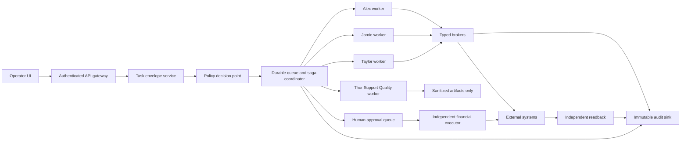

<!-- AgentChat/direct_codex 2026-07-15T00:07:07-04:00: audit-ready Command Center least-privilege and GCP migration plan. -->

# Command Center Security, Lane Isolation, and GCP Migration Plan

Status: proposed plan; no production changes are authorized by this document

Owner: Darius / Command Center platform owner

Prepared: 2026-07-15

Review cycle: update after every migration phase and before an external audit

Identity note: Thor — Support Quality is the visible identity.
`claude_agent` is retained only as a compatibility runtime ID. Historical
findings that say Claude preserve the display label used when that evidence was
recorded.

## 1. Outcome and guiding decision

The Command Center can preserve its current task coverage while becoming safe
enough for a nontechnical operator by changing what an agent receives. Agents
should receive a task-scoped capability, not a credential, broad tool, shared
browser, or general production connection.

The target operating model is:

```text
operator request
  -> structured task and policy envelope
  -> lane router and durable workflow coordinator
  -> least-privilege agent worker
  -> typed business-operation broker
  -> external system
  -> independent readback
  -> immutable audit event
```

The plan deliberately preserves the documented responsibilities and recurrent
workflows. It removes access paths that are broader than the work requires.

### Non-negotiable invariants

1. An agent never receives or can retrieve a production credential.
2. Every worker, broker, and executor starts with no permissions and receives an
   explicit allowlist.
3. Authority can only narrow during an agent-to-agent handoff.
4. Ticket, email, webpage, attachment, model output, and retrieved text are data,
   never authorization.
5. A mutation is a named business operation with an exact target, permitted
   fields/effects, idempotency key, and readback—not arbitrary HTTP, shell, SQL,
   or browser access.
6. Refunds and rate changes require exact signed task authority, a resolved
   target and value, durable intent journaling, idempotency, and readback; a
   changed or ambiguous effect requires Darius's decision.
7. Salesforce and Maxio/Chargify deletion remains permanently forbidden.
8. Jamie's retired location-reconciliation automation remains impossible to
   submit, schedule, recover, or re-enable.
9. A broker or audit outage fails closed for writes. It cannot trigger a retry
   through a second tool or browser path.
10. The platform can pause queues without losing the original request, evidence,
    approval, agent result, or audit chain.

## 2. Audit scope and method

This audit reviewed the current agent configuration, responsibility documents,
orchestration design, safety classifier, secret-broker implementation, tool and
pipeline registries, MCP configuration, job metadata, runtime session metadata,
shared-chat metadata, artifact-index metadata, tests, and current GCP service
metadata. It did not read secret values or customer payloads.

Evidence anchors:

- [Platform map](AGENT_PLATFORM_MAP.md)
- [Responsibility matrix and gaps](agent-responsibilities/RESPONSIBILITY_MATRIX_AND_GAPS.md)
- [Orchestration and handoffs](agent-responsibilities/ORCHESTRATION_AND_HANDOFFS.md)
- [Secret broker migration](SECRET_BROKER_MIGRATION.md)
- [Agent configuration](../config/agents.yaml)
- [Runtime process construction](../src/codex_slack_bridge/agents.py)
- [Safety policy](../src/codex_slack_bridge/safety.py)
- [Capability router](../src/codex_slack_bridge/capabilities.py)
- [Typed secret broker](../src/codex_slack_bridge/secret_broker.py)

### Current workload evidence

The local job archive contains 1,636 jobs:

| Agent | Historical jobs | What the volume confirms |
|---|---:|---|
| Taylor / `coding_agent` | 724 | Engineering, Singapore, watchers, email intake, dashboard, and hosted operations are a large operational lane. |
| Alex / `tickets_agent` | 554 | Support-ticket investigation is a distinct high-volume lane. |
| Jamie / `billing_agent` | 357 | Billing investigation is a distinct lane; 273 obsolete reconciliation jobs must remain historical only. |
| Thor — Support Quality / `claude_agent` compatibility ID | 1 | The archived job used the former Claude display label and records an occasional delegated-review workload under the old operating model, not current Thor authority or production integration ownership. |

The most common historical source types were reconciliation (273, retired),
Singapore FTP (269), ticket refresh (219), email watch (196), support-email
intake (174), direct agent chat (125), KPI refresh (125), and dispatch (98).
This supports operation-specific brokers rather than one generic connector.

The platform also has 830 session records, 1,602 shared-chat events, and 2,260
artifact-index entries. These are operationally useful but create a meaningful
cross-task disclosure surface if every lane can read the same storage.

## 3. Current-state findings

### Controls already worth keeping

- Signed provenance distinguishes verified operator/delegation instructions
  from untrusted retrieved content.
- The runtime scrubs sensitive-looking environment variables for ordinary jobs
  and removes Salesforce/Maxio variables even from trusted inherited mode.
- Read-only proactive ticket task kinds are enforced at runtime.
- The secret-broker code already uses typed operations, agent allowlists,
  argument allowlists, credential leases, response validation, and denial logs.
- Permanent service-level Salesforce/Maxio delete denials exist.
- Financial proposals are bound to an exact hash before execution.
- External writes use preview, idempotency, read-before-write, and post-write
  readback conventions.
- The responsibility and handoff documents already contain a usable business
  RACI and identify most of the important ownership conflicts.

These should become mandatory platform controls rather than prompt guidance.

### Critical gaps

| ID | Finding | Risk | Required treatment |
|---|---|---|---|
| C-01 | All primary Codex workers ran with `danger-full-access`; the worker then displayed as Claude used a permission-bypass flag. That worker is now Thor — Support Quality, with `claude_agent` retained only as its compatibility runtime ID. | A prompt, shell, browser, or coding mistake can escape the intended lane. | Replace host processes with isolated lane workers and no host mounts. |
| C-02 | Agents share one Windows identity, filesystem, browser state, credential locations, runtime registry, sessions, and journals. | Instruction boundaries are not security boundaries. | Separate runtime identities and task-scoped storage. |
| C-03 | MCP control is denylist-based (`disabled_mcp_servers`). | A newly installed or renamed MCP can become available by default. | Generate an explicit per-lane allowlist; reject unknown tools at startup. |
| C-04 | `tool_fast_paths_excluded` changes guidance, not underlying availability. | A hidden or alternate route can still be invoked. | Enforce capabilities at the gateway and broker. |
| C-05 | The capability router scores relevance and readiness; it is not an authorization engine. | Routing can be mistaken for permission enforcement. | Keep routing separate from a policy decision point. |
| C-06 | Trusted jobs can inherit ambient secrets other than blocked service prefixes, and the same OS identity can access local vaults/ADC/browser sessions. | Environment scrubbing cannot guarantee secret isolation. | Agent workers get no secrets, vault paths, ADC, or Secret Manager IAM. |
| C-07 | Signed messages bind content and source but lack expiry, nonce, one-time consumption, and parent-authority constraints. | A valid old request can be replayed or delegated too broadly. | Use expiring, nonce-backed, single-use task envelopes. |
| C-08 | The broker audit buffer is a bounded in-memory deque, and sink failures are swallowed. | Security events can be lost without stopping a write. | Durable synchronous write-ahead audit for mutations; alert and fail closed. |
| C-09 | `raw_codex` is a persistent, unrestricted escape hatch. | Routine operators or agents can bypass normal governance. | Disable by default; replace with ephemeral break-glass workflow. |
| C-10 | Shared browser/CDP sessions can reach authenticated UI routes outside an API allowlist. | Browser automation can bypass broker controls. | Dedicated ephemeral UI executor with domain/action allowlists. |
| C-11 | Multiple execution planes lack one resource-level lock and durable saga. | Duplicate or conflicting writes can occur across agents and automations. | Central workflow coordinator and resource locks. |
| C-12 | Local loopback state-changing routes rely on locality/origin, not a per-launch cryptographic token. | Another same-user process can attempt state changes. | Authenticated operator session, CSRF protection, nonce, and local IPC hardening. |
| C-13 | Role documents contain drift, including Jamie's now-retired reconciliation ownership. | A future maintainer can reintroduce unsafe behavior from stale docs. | Version a machine-readable capability contract and generate human docs from it. |

### Current GCP observations

Read-only verification on 2026-07-15 found:

- Project `supportkpis` has no Cloud Run services/jobs and zero Secret Manager
  secrets. It can be used as a clean security/broker project if governance and
  billing ownership are appropriate.
- Project `gen-lang-client-0051653266` currently runs `logmein-connector` in
  `us-central1` and `rainfall` in `us-south1`, plus related jobs.
- Both services currently use the project's default compute service account.
- Both services accept ingress from all network paths, although neither grants
  the Cloud Run invoker role to `allUsers`.
- No secrets were listed in Secret Manager in either inspected project.

The migration must not place new agent or broker workloads on the default
compute identity. Existing service identities and ingress should be reviewed as
separate production-hardening work, not silently changed by this plan.

## 4. Target architecture



### GCP project and identity model

Use at least three projects, preferably under one GCP organization:

| Project class | Contents | Key boundary |
|---|---|---|
| Control plane | Operator API, router, policy decision point, queue, workflow coordinator | No production service credentials. |
| Broker/data plane | Typed brokers and isolated executors | Each service account can access only its own secret and destinations. |
| Audit/security | Logging sink, alerting, policy evidence, immutable archive | Agent and broker identities cannot alter or delete retained logs. |

Production and staging must be separate projects. Do not use project names or
UI colors as the only environment boundary.

Create one service account per deployable service. Prohibit service-account
impersonation by agent workers. Agent workers get only `run.invoker` for the
specific broker operations they need, or preferably invoke through the control
plane using an internal signed capability. They receive no Secret Manager role.

Use private ingress where feasible, authenticated Cloud Run, VPC Service
Controls where supported, serverless VPC access for private data sources, and
an egress proxy with destination allowlists. Public research must use a separate
sanitizing service that rejects customer identifiers.

## 5. Machine-readable capability contract

Make one versioned policy repository the source of truth. Human role documents,
tool registration, broker authorization, UI templates, and tests should be
generated or validated against it.

Each capability entry must include:

```yaml
capability: billing.prepare_refund
owner_lane: jamie
systems: [salesforce, maxio]
mode: read_and_propose
resource_scope: ticket_and_resolved_customer
allowed_fields: [ticket_id, customer_id, invoice_id, transaction_id, amount, currency]
approval_class: financial_exact
broker: billing-read
result_classification: customer_confidential
result_limit: 100
delegable_to: []
delegation_mode: none
```

Policy changes require code review, generated tests, an owner, a reason, an
expiry for temporary grants, and a release record. Unknown capabilities,
agents, tools, fields, systems, and endpoints fail closed.

Thor quality tasks are admitted separately by Command Center under the
read-only support-quality capability. This billing capability does not delegate
to Thor, and Thor has no outbound delegation authority.

## 6. Task and delegation envelope

Every task must have an immutable, signed envelope containing:

- task ID, workflow ID, and parent task ID;
- operator identity, source channel, and authenticated session;
- assigned lane and explicitly permitted delegate lanes;
- exact systems, objects, records/accounts/tickets, operations, and fields;
- read-only or mutation mode;
- data classification and disclosure ceiling;
- approval class and approved proposal hash when applicable;
- amount, currency, rate, recipient, environment, and expected effects when
  relevant;
- creation and expiry timestamps;
- cryptographic nonce and one-time-use state;
- idempotency key and resource-lock key;
- policy version and parent-authority hash.

A delegated envelope is valid only if its permissions are the intersection of
the parent's authority and the receiving lane's static capabilities. It cannot
add a system, operation, field, record, amount, duration, mutation mode, or data
classification. A handoff sends structured references and minimum evidence,
not an entire transcript or credential-bearing artifact.

## 7. Lane capability matrix

### Direct Codex / General Operator

Allow:

- intake, routing, workflow status, policy inspection, and cross-lane summaries;
- read-only discovery needed to identify the owning lane;
- creation of child tasks whose authority is a strict subset of the parent;
- emergency pause and escalation through a dedicated operator control.

Deny:

- production credentials and ordinary production mutations;
- broad customer-data queries after the owner is resolved;
- direct financial, ticket, email, deployment, SQL, or Zoom-admin execution;
- access to another lane's private scratch storage.

### Alex / Support

Allow:

- scoped Salesforce support ticket, Chatter, Account, Contact, and related-ticket reads;
- bounded ticket note/status operations when explicitly authorized;
- Nova support SQL through a read-only principal and named report operations;
- live Rescue session reads and explicitly requested session actions through a typed broker;
- read-only Zoom support-monitor evidence and the established weekly Yaron workflow;
- customer-safe drafts and support-to-engineering or support-to-billing handoffs.

Deny:

- Maxio mutations, refunds, credits, rates, subscription decisions, and tax conclusions;
- GCP, GitHub deployment, Zoom admin, and general hosted operations;
- unrestricted SQL and customer sends from autonomous research;
- fallback-account writes when unique identity is required.

### Jamie / Billing

Allow:

- scoped Salesforce billing ticket/customer reads and bounded billing notes;
- BillingAutomation and Maxio/Chargify reads plus guarded non-delete writes;
- refund, credit, rate, cancellation, and allocation previews;
- exact lane-owned financial operations authorized by the verified request or
  signed ticket assignment, with durable intent, idempotency, and readback;
- Salesforce ticket updates/closure and required customer notifications;
- finance-safe drafts and billing-to-engineering handoffs.

Deny:

- direct access to a financial mutation credential;
- permission, identity, credential, MCP, Salesforce Setup, or IAM administration;
- asking Rory, local Codex, or another agent to widen permissions or execute as
  a bypass;
- the retired reconciliation task and all of its scheduler/source/recovery paths;
- Salesforce or Maxio deletion;
- GCP, GitHub, Zoom admin, Rescue, Singapore, and general support ownership.

### Taylor / Engineering and Operations

Allow:

- explicitly scoped repositories, branches, pull requests, CI runs, packages,
  and deployment pipelines;
- named GCP projects, Cloud Run services/jobs, logs, metrics, environment names,
  and approved deployment/configuration operations;
- Zoom admin/configuration and connector operations;
- deterministic Singapore runner operations;
- email intake/triage operations and explicitly authorized customer delivery;
- Command Center engineering and operational incident response.

Deny:

- billing decisions or financial execution;
- broad Salesforce or Nova data unrelated to an engineering incident;
- live Rescue customer sessions;
- arbitrary repositories, projects, service accounts, secrets, or cloud resources;
- direct database writes unless an exact engineering repair has a separate write envelope.

### Thor — Support Quality (`claude_agent` compatibility ID)

Allow:

- fixed-roster, read-only Zoom quality evidence and transient bounded transcript
  evidence;
- the four read-only Rescue status, session, performance, and chat-log
  operations;
- sanitized prior quality summaries, coverage analysis, coaching gaps, and the
  weekly support-meeting agenda;
- schema-valid, sanitized quality findings returned to Command Center.

Deny:

- Salesforce, Gmail, ticket work, customer messages, Zoom or Rescue sends,
  provider administration, repository implementation, or any live mutation;
- raw transcript persistence, customer identifiers in durable output, and
  agent-to-agent handoffs or delegation. Sanitized connector gaps return to
  Command Center for operator routing.

### Raw Codex / Break Glass

Replace the persistent raw lane with an ephemeral incident-only worker:

- disabled by default;
- Darius plus a second approver for production access;
- MFA, reason, exact target, prohibited actions, 30-minute maximum lifetime;
- no inherited credentials; only incident-specific broker capabilities;
- full command metadata and screen/session recording where legally appropriate;
- automatic termination and credential revocation;
- mandatory post-incident review.

It must never appear as a normal routing choice for a nontechnical operator.

## 8. Broker and executor catalog

Expose business operations, not provider APIs:

| Broker/executor | Example operations | Key restrictions |
|---|---|---|
| Salesforce Support Read | `read_ticket`, `read_ticket_feed`, `read_account_context`, `find_related_tickets` | Ticket/account scoped; field and row limits. |
| Salesforce Ticket Write | `append_technical_note`, `post_chatter`, `set_ticket_status`, `close_ticket` | Exact record; duplicate readback; field allowlist; no delete. |
| Billing Read | `read_subscription`, `read_invoice`, `read_transaction`, `read_billingautomation_locations` | Resolved customer only; bounded results. |
| Scoped Maxio Operations | `maxio_api_request` with `GET`, `POST`, `PUT`, or `PATCH` | Jamie/Taylor lane only; exact path/body; stable idempotency key; durable intent; readback; no credential return, permission admin, or delete. |
| Financial Review | `prepare_refund`, `prepare_rate_change`, `prepare_credit`, `prepare_cancellation` | Used for genuinely ambiguous target/value/effect, not as a blanket read-only gate. |
| Nova SQL Read | `describe_schema`, `support_invoice_lookup`, `account_health_report` | Read-only DB principal; parameterized; result ceilings; statement timeout. |
| Nova SQL Write | `execute_approved_repair` | Separate principal; preview hash; transaction; row ceiling; rollback/readback. |
| Gmail Read | `read_thread`, `search_scoped_mail`, `triage_inbox` | Mailbox/query allowlists; attachment scanning; bounded bodies. |
| Gmail Send | `send_approved_reply`, `send_template_notification` | Exact recipients/thread/body hash; duplicate readback. |
| Zoom Support Read | `read_support_chat`, `read_session_evidence` | Support scope only. |
| Zoom Admin | `read_configuration`, `apply_approved_configuration` | Taylor only; exact account/object/fields; configuration readback. |
| Rescue Session | `find_session`, `read_session`, `send_approved_message`, `create_pin` | Alex only; exact session/customer; no connector admin. |
| GitHub | `read_repo`, `create_branch`, `open_pr`, `merge_approved_pr`, `run_workflow` | Repo/ref allowlist; protected branches; required checks. |
| GCP Operations | `read_service`, `read_logs`, `deploy_revision`, `set_traffic`, `update_named_env` | Taylor only; project/region/service allowlist; no general IAM or secret payload reads. |
| Singapore Runner | `scan`, `upload_validated_batch`, `read_status`, `create_remediation_ticket` | Deterministic input schema; no free-form FTP client. |
| Ephemeral UI Executor | Named UI-only action templates | Domain/action allowlist; fresh browser profile; screenshot audit; no stored sessions. |

Do not expose raw provider URLs, methods, arbitrary SOQL, arbitrary SQL, generic
HTTP, general shell, Secret Manager reads, or credential-return operations.

## 9. Data minimization and storage

Classify data as public, internal, customer confidential, payment sensitive,
credential, or security audit. Default agent output is internal; ticket/account
data is customer confidential; payment details and credentials are never placed
in prompts or artifacts.

Implement:

- ticket/account-scoped Salesforce views and field allowlists;
- parameterized Nova reports with row, date-range, and timeout limits;
- account-scoped billing reads;
- task-scoped encrypted scratch storage with automatic expiry;
- artifact ACLs for creator lane, accountable lane, and explicit delegates;
- per-task memory namespaces; only curated, de-identified learning can cross tasks;
- sanitized errors that do not reveal tokens, queries, infrastructure details,
  or unrelated customer records;
- attachment malware/type/signature/size validation before model access;
- no full transcript replication during handoff;
- retention schedules with legal/business owner approval.

Recommended defaults: agent scratch 7 days, ordinary task evidence 90 days,
financial and mutation audit metadata 7 years or the company-approved finance
retention period, security-denial events at least 1 year. Confirm these with
legal/accounting before enforcement.

## 10. Foolproof operator experience

The normal UI should make the safe path the easiest and hide expert escape hatches.

1. Route from a structured task type, not from a raw agent picker.
2. Resolve and display the exact environment, customer/account, ticket, service,
   repository, amount, recipient, and intended effect before consequential work.
3. Show `Read only`, `Will change`, and `Requires approval` badges generated
   from policy—not model text.
4. Use previews for every customer send, closure, deployment, financial action,
   SQL repair, and configuration change.
5. Financial cards show the immutable proposal hash, current value, proposed
   value, amount/rate/currency, reason, expected proration/credit/charge, and
   exact readback checks.
6. A changed target, amount, rate, recipient, or expected effect invalidates approval.
7. Hide internal prompts and raw instructions. Show findings, proposed action,
   evidence, impact, approval request, and verified result.
8. Keep backward board transitions, cancellation, pause, and reassignment safe
   without erasing evidence.
9. Provide per-operation, per-lane, and global mutation kill switches.
10. Never auto-fallback from API/broker failure to browser, shell, or another provider path.
11. Require a separate advanced administration area for policy changes, protected
    by MFA and role-based access. A normal operator cannot install tools, add
    endpoints, grant capabilities, change service accounts, or enable break glass.

## 11. Durable orchestration and collaboration

Use one workflow coordinator with:

- durable queues and resumable saga state;
- one lease/resource lock for each external record or logical account;
- explicit steps: resolve, read, investigate, propose, approve, execute, read back, close;
- source-event deduplication and operation idempotency;
- timeouts that transition to `uncertain` and force readback before retry;
- compensation/rollback definitions where the provider supports them;
- a dead-letter queue that retains full context without manufacturing review cards;
- review creation only when a specific operator decision and substantive evidence exist.

Collaboration messages carry task references and bounded evidence. The receiving
lane cannot inherit the sender's tools; it evaluates the delegated envelope
against its own static capability contract.

## 12. Audit, detection, and incident response

Every task, policy decision, delegation, disclosure, broker call, downstream
request, mutation, readback, artifact, approval, denial, timeout, and retry must
produce a correlated event containing:

- workflow/task/request IDs and parent authority hash;
- operator and lane identities;
- policy and broker versions;
- operation and resource identifiers;
- approved effect metadata;
- before/after hashes, never secret payloads;
- decision, denial reason, latency, downstream request ID, and readback result.

Mutation brokers must write the intent event durably before execution and the
result/readback event afterward. If the audit sink is unavailable, writes stop.

Send logs to the audit project using a sink identity. Store immutable copies in
a retention-locked bucket or equivalent approved archive. Agent, worker, and
broker service accounts must not have log deletion or retention-policy access.

Alert on:

- cross-lane and unknown-operation attempts;
- replayed, expired, broadened, or altered envelopes;
- denied secret/identity impersonation;
- unexpected data volume or result sizes;
- generic HTTP, shell, browser, or egress attempts from workers;
- financial proposals without approval or approval-hash mismatch;
- deletion attempts in Salesforce/Maxio;
- reconciliation source/task submissions;
- audit gaps, duplicate mutations, failed readbacks, and unusual retry volume;
- policy changes and break-glass activation.

Maintain runbooks for credential exposure, prompt injection, duplicate/uncertain
write, compromised worker, broker outage, audit outage, queue corruption, and
provider incident. Exercise them at least twice per year.

## 13. Migration sequence

### Phase 0 — Freeze and inventory (weeks 0–2)

Deliverables:

- freeze new generic MCPs/endpoints and document an exception process;
- export a sanitized 90-day capability-use inventory;
- map every agent/task to systems, operations, fields, data classes, approvals,
  credentials, endpoints, and handoffs;
- correct role-document drift, especially retired reconciliation ownership;
- identify every credential copy, browser profile, vault, ADC identity, service
  account, local helper, and direct network path;
- baseline task success, latency, manual review, duplicate, and failure rates.

Exit: each recurring task has an accountable owner and a minimum capability set.

Rollback: documentation/inventory only; no runtime effect.

### Phase 1 — Policy as code in observation mode (weeks 2–5)

Deliverables:

- machine-readable capability contract;
- explicit per-lane MCP/tool/endpoint/filesystem/network allowlists;
- policy-decision logs in shadow mode;
- generated compatibility and negative tests;
- UI display of inferred task type, lane, and effective authority.

Exit: 30 days of representative jobs show no unexplained required capability;
every off-lane path is identified.

Rollback: disable shadow evaluation without changing current execution.

### Phase 2 — Task envelopes and workflow coordinator (weeks 4–8)

Deliverables:

- expiring nonce-backed single-use envelopes;
- capability-reducing delegation;
- resource locks, sagas, deduplication, idempotency, and uncertain-write readback;
- durable pause/recovery/dead-letter handling.

Exit: replay, broadening, duplicate, and conflicting-resource tests all fail safe.

Rollback: route through the prior coordinator while retaining new audit records;
do not discard task history.

### Phase 3 — Typed brokers in shadow and staging (weeks 6–12)

Deliverables:

- read brokers first, then bounded write brokers;
- independent financial, SQL-write, email-send, ticket-write, deployment, and UI executors;
- durable mutation audit;
- no credential-return interface.

Exit: representative historical tasks produce equivalent results in staging;
broker policy rejects every negative case.

Rollback: per-operation traffic reversal; never copy broker credentials into workers.

### Phase 4 — Per-lane GCP workers (weeks 10–16)

Deliverables:

- separate Cloud Run service/job and service account per lane;
- immutable container images, read-only roots, isolated scratch volumes;
- no host mounts, Docker socket, shared browser profile, local vault, ADC, or
  Secret Manager role;
- egress allowlists and authenticated private service calls;
- ephemeral Thor — Support Quality and break-glass workers.

Exit: from every worker, prove other lanes' data, identities, tools, and
destinations are inaccessible.

Rollback: canary traffic reversal to the previous worker version; never restore
shared local secrets.

### Phase 5 — Credential-by-credential cutover (weeks 12–20)

For each credential:

1. create a dedicated broker identity and least-privilege upstream credential;
2. store a pinned version in Secret Manager;
3. enable the typed operation in staging and shadow production;
4. canary one workflow and verify task parity, audit, and readback;
5. switch production traffic;
6. rotate/revoke every local, environment, browser, helper, and previous-service copy;
7. prove workers cannot retrieve or use the secret;
8. close the rollback window after a defined soak period.

Do not migrate several high-impact credentials in one change window.

### Phase 6 — Operator UI and governance (weeks 16–22)

Deliverables:

- safe task templates, exact-target previews, environment badges, and approval cards;
- role-based administration, MFA, kill switches, and break-glass workflow;
- policy change review and generated docs/tests;
- operator training and concise runbooks.

Exit: a nontechnical acceptance tester can perform all routine workflows but
cannot expand scope, install a tool, reveal a secret, bypass approval, or select
an unsafe fallback.

### Phase 7 — Enforcement, soak, and independent audit (weeks 20–28)

Deliverables:

- deny-by-default enforcement;
- removal of shared local runtime credentials and persistent raw access;
- 30-day production soak with task-parity and security metrics;
- threat model, penetration test, IAM review, application authorization review,
  tenant/data isolation review, incident-response exercise, and disaster-recovery test;
- remediation evidence and final auditor packet.

Exit: all P0/P1 findings are closed or formally risk-accepted with owner/expiry.

## 14. Acceptance and regression test matrix

The release gate must include at least:

1. Replay representative successful tasks for Alex, Jamie, Taylor, Direct Codex,
   and Thor — Support Quality and compare business results, not model wording.
2. For every lane × operation pair, prove required operations succeed and all
   off-lane operations fail.
3. From every worker, prove environment secrets, vaults, ADC, Secret Manager,
   service-account impersonation, other lanes' storage, browser sessions,
   unauthorized MCPs, generic HTTP, and unauthorized egress are inaccessible.
4. Test expired, replayed, altered, duplicate, cross-agent, broadened, wrong-target,
   and wrong-environment envelopes.
5. Test prompt injection in tickets, email, webpages, attachments, artifacts,
   agent output, and delegated messages.
6. Test refund/rate preview, exact approval binding, changed-proposal rejection,
   one-time execution, idempotency, timeout readback, and duplicate prevention.
7. Prove the retired reconciliation task cannot be created through scheduler,
   poller, recovery, direct dispatch, API, UI, delegation, or old persisted state.
8. Prove Salesforce and Maxio deletion fails through broker, provider alias,
   generic HTTP, CLI, shell, SQL/proxy path, browser, and delegated task.
9. Test SQL statement/row/time limits and transaction rollback.
10. Test email recipient/body hash changes, ticket closure target changes,
    deployment project/service changes, and Zoom object changes.
11. Simulate downstream timeout, broker timeout, audit outage, queue restart,
    partial write, failed readback, and duplicate source event.
12. Verify every successful and denied call creates exactly one durable correlated
    audit record without secrets or unnecessary customer data.
13. Execute a canary rollback for worker, broker, policy, and secret versions
    inside the declared recovery window.

Task parity gates:

- at least 99% of previously successful routine tasks remain executable;
- no unexplained increase in manual review;
- zero unauthorized successful operations;
- zero duplicate financial/customer-facing mutations;
- 100% of mutations have intent, downstream identifier, and verified readback;
- 100% of policy denials are durably logged.

## 15. External audit packet

Provide the auditor:

- system/data-flow and trust-boundary diagrams;
- agent, worker, broker, endpoint, network, service account, IAM, secret, and
  data-store inventories;
- versioned capability matrix and delegation rules;
- threat model covering prompt injection, confused deputy, replay, lateral
  movement, data exfiltration, duplicate writes, insider/operator error, and
  supply-chain compromise;
- upstream Salesforce, Maxio, Google, Zoom, Rescue, GitHub, and database
  permission evidence;
- Secret Manager IAM and rotation records without secret values;
- Cloud Run ingress/egress, service identity, and deployment provenance;
- policy decision, denial, mutation, readback, and break-glass sample logs;
- test plans/results, historical replay results, penetration-test report, and
  remediation register;
- incident response, backup/restore, disaster recovery, retention/deletion,
  vulnerability management, dependency/SBOM, key management, and access-review procedures;
- operator and administrator training records;
- a list of accepted risks with owner, rationale, compensating control, and expiry.

Suggested audit frameworks: use SOC 2 Security/Availability as the operational
control structure and map technical controls to NIST CSF 2.0 or CIS Controls.
If payment-card data is ever handled directly, obtain a PCI DSS scoping opinion;
the preferred design is to keep card data completely outside the agent platform.

## 16. Prioritized backlog

### P0 — Start before adding more integrations

- Freeze generic tool/MCP additions.
- Create the capability-use inventory and machine-readable contract.
- Add expiry, nonce, one-time consumption, and parent authority to signed tasks.
- Make MCP/tool availability allowlist-only.
- Make mutation audit durable and fail closed.
- Keep reconciliation and delete denials as permanent regression tests.
- Disable persistent Raw Codex and keep Thor — Support Quality
  (`claude_agent` compatibility ID) on the isolated Codex-only, read-only
  worker; the former Claude permission-bypass path must remain retired.
- Decide GCP organization, project, region, and audit ownership.

### P1 — Required before production GCP agent migration

- Deploy read brokers and per-lane workers in staging.
- Separate service accounts and egress destinations.
- Add artifact ACLs and task-scoped storage/memory.
- Implement resource locks and durable sagas.
- Build the independent financial executor and other mutation executors.
- Remove shared browser sessions; add ephemeral UI executor.
- Replace arbitrary SQL with read reports and a separate approved repair executor.
- Add the operator-safe UI, kill switches, and administration boundary.

### P2 — Required before handoff to another manager

- Complete credential cutover and revoke all local copies.
- Run a 30-day enforcement soak and historical task-parity replay.
- Complete penetration, IAM, incident-response, and disaster-recovery exercises.
- Train the new manager using routine and emergency simulations.
- Finish external audit and close or time-bound every material finding.

## 17. Decisions to record before implementation

Recommended defaults are supplied so implementation does not stall:

| Decision | Recommended default |
|---|---|
| GCP ownership | One company-controlled organization with separate control, broker, audit, staging, and production projects. |
| Regions | Keep customer-data processing in approved US regions; document the existing `us-south1` exception before migration. |
| Human approval | Darius is financial approver initially; add a named backup with the same exact-proposal process. |
| Break glass | Dual approval, MFA, 30-minute expiry, incident ticket, automatic revocation. |
| Raw agent | Removed from normal UI and disabled outside break glass. |
| Audit retention | Mutation/financial metadata 7 years subject to legal/accounting confirmation; security events at least 1 year. |
| Worker internet | Denied by default; only broker endpoints and explicitly approved public research proxy. |
| Browser automation | UI executor only, for proven UI-only operations. |
| Policy administration | Separate administrator role; normal operator cannot change capabilities or integrations. |

## 18. Definition of done

The migration is complete when every currently approved recurring task has a
tested capability contract and succeeds through the new architecture, while:

- workers have no production secrets or broad provider clients;
- each lane is technically unable to perform off-lane work;
- delegation can only reduce authority;
- all mutations use typed executors with idempotency and readback;
- financial approvals are exact and one-time;
- destructive denials and retired workflows cannot be bypassed;
- customer data is task-scoped and auditable;
- a nontechnical operator can safely run routine work without seeing internal
  prompts or security controls;
- an independent auditor can reproduce the IAM, policy, test, logging, incident,
  and recovery evidence.
