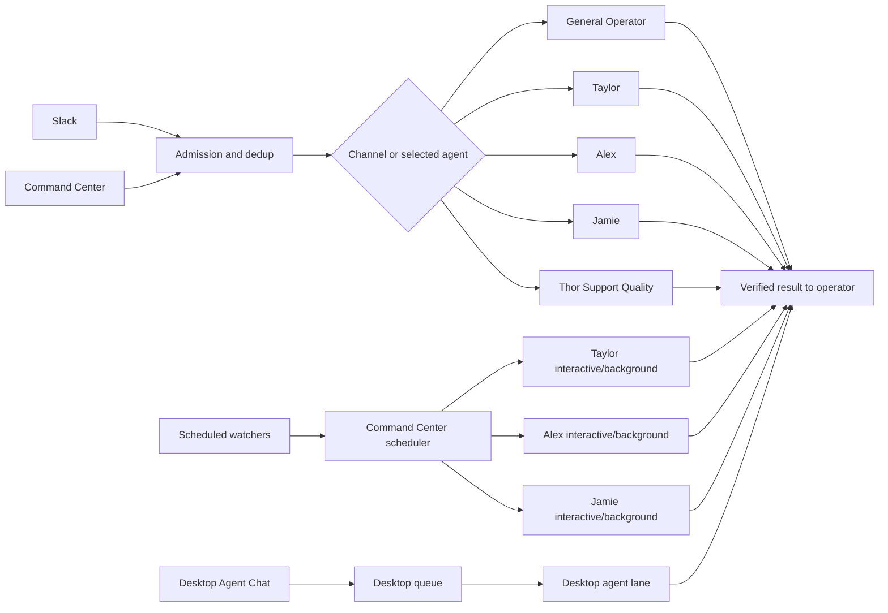
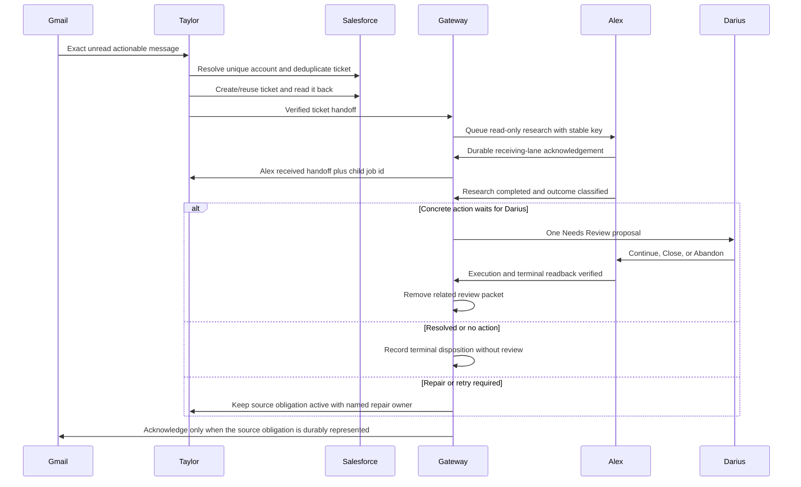

# Orchestration and Handoff Responsibilities

- Status: official current-state process description with target-state controls
- Last audited: 2026-07-30
<!-- AgentChat/direct_codex 2026-07-29T20:43:00-04:00 -->
<!-- AgentChat/coding_agent 2026-07-30T17:15:00Z -->

## Orchestrator charter

The Command Center gateway and Slack bridge are system components, not department
personas. They are responsible for transporting and sequencing work without
changing the business meaning or authority of the request.

The orchestrator owns:

- source admission, operator allowlisting, and trusted internal signatures;
- durable job identity, idempotency, retry classification, and terminal state;
- lane admission, worker capacity, coalescing of replaceable refreshes, and pause/restart recovery;
- deterministic fast paths that should not use a general model;
- cross-agent handoff ordering and readback gates;
- shared chat, artifact, cache, review-packet, and audit projections;
- surfacing terminal failures, non-review recovery status, and expired handoffs.
- hash-verified staging of up to five source-lane files on an explicit handoff,
  with seven-day expiry and target-lane ACL assignment;
- hourly cleanup of terminal job projections beyond 500 items or 30 days while
  preserving queued/running jobs and durable provider/audit ledgers.

The orchestrator does not own:

- deciding an ambiguous customer/account/business outcome;
- widening a request's authority;
- inventing credentials, account mappings, recipients, or completion evidence;
- treating queue acceptance as business completion;
- silently retrying an uncertain external write.

## Current input surfaces

| Surface | Current route | Durability | Current concurrency behavior |
|---|---|---|---|
| Slack `codex-sql` | Rory / `direct_codex`; singleton operator allowlist only | SQLite job ledger and Slack event deduplication | Per-channel and per-agent bridge locks; no shared runtime session or subagent; tracked outbound specialist continuations only |
| Slack `codex-dev` | Taylor / `coding_agent` | SQLite job ledger | Same as above |
| Slack `codex-support` | Alex / `tickets_agent` | SQLite job ledger | Same as above |
| Slack `codex-salesforce` | Jamie / `billing_agent` | SQLite job ledger | Same as above; generic Salesforce naming is ambiguous |
| Slack `thor-support-quality` | Thor / `claude_agent` | SQLite job ledger | Same as above; provider readiness and Thor's read-only quality contract remain enforced |
| Command Center direct chat | Selected alias/agent | SQLite plus job JSON | Separate interactive lane per agent |
| Command Center dispatch/review | Selected packet owner | SQLite plus job JSON | Interactive lane; review state projected separately |
| Scheduled Command Center watchers | Taylor, Alex, or deterministic runner | SQLite plus job JSON/cache | Separate background lane per agent; capacity reserved for interactive work |
| Desktop Agent Chat | Selected agent | Conversation is persisted; execution queue is in memory | Per-agent desktop queue with a different runtime lock namespace |
| Voice | Selected Command Center agent | Command Center job | Transcription is non-authoritative for live writes until typed confirmation |

## Current routing model

This diagram describes transport, not a unified lock. The current runtime has
multiple independent execution planes. Command Center background and mutating
jobs are intentionally fresh and ephemeral to prevent stale session context,
but they therefore do not share the persistent conversation lock used by Slack.
Desktop uses a separate lock identity again. Safe parallel read work is
possible, but same-resource writes require explicit idempotency and resource
coordination because the agent name alone is not a global mutex.

Before model execution, the execution navigator ranks the shared pipeline and
tool registries and supplies the shortest known process, tool entrypoints, and
readback step. It is advisory and cannot widen or reduce the lane contract.
Demand-based model selection uses Terra only for simple or bounded routine work
and keeps Sol for writes, ambiguity, attachments, billing, production, and
complex work. Warm sessions are separated by selected model so switching demand
classes does not repeatedly invalidate the other model's session.

## Lane and worker rules

Implemented behavior:

- Rory is excluded from inbound inter-agent orchestration. Only authenticated operator
  direct-chat/voice sources and Rory's singleton Slack member ID may enter the
  lane; no lane delegates to Rory. Rory may dispatch a bounded continuation of
  the operator's original request to Taylor, Alex, Jamie, or Thor. The
  specialist result returns to the originating operator request.

- Command Center uses `agent:interactive` and `agent:background` lane keys.
- Only one job runs within one lane key at a time.
- Interactive and background jobs for the same named agent may overlap.
- With more than one worker, one worker is reserved from background saturation.
- Steering/direct work has higher queue priority than general/background work,
  but a queued priority does not interrupt an already-running job.
- An acknowledged operator-authorized handoff runs before unrelated new
  dispatches in the target lane. Ordinary and enforced-read-only agent
  handoffs remain below new operator dispatches, and FIFO order is preserved
  within each authority class.
- Replaceable refresh jobs can coalesce; transactional source obligations must
  not be coalesced away.
- Autonomous/background and mutating Command Center jobs run in fresh ephemeral
  sessions and do not resume reusable CLI conversations.
- Slack uses durable jobs, Slack event deduplication, and its own channel/agent
  admission locks.
- Slack and Command Center agent workers use at most three bounded attempts for
  retryable transport/tool/runtime failures. Every continuation preserves the
  original target and idempotency key and requires same-surface readback before
  another external write.
- Normal model-worker timeout or gateway restart requeues recoverable agent work
  on the same durable job. Recovery includes heartbeat/progress evidence and
  bounded backoff. Deterministic runners, transient attachment jobs, exhausted
  retries, and genuinely uncertain mutations remain quarantined for their
  purpose-built same-surface readback; they are never blindly replayed.
- A receiving-lane acknowledgement moves the origin to
  `handoff_acknowledged`; it does not terminalize the origin. The child terminal
  receipt closes the source/origin obligation and reopens Slack terminal
  delivery when the handoff began there.
- Cross-system operator continuations allow up to eight lane transitions (four
  complete Taylor/Jamie round trips). At the last transition, the receiving
  lane must return a terminal current-state receipt instead of another handoff.
  This remains bounded and does not create an inbound route to Rory.
- A production lane may emit a registry-bound verified-route receipt only after
  successful readback or focused tests. The gateway strips the internal marker,
  persists only safe registry vocabulary and verification class, and offers the
  route as advisory guidance to later matching work on that same lane.
- Desktop has a per-agent in-memory execution queue; a desktop restart can lose
  the queued execution obligation even when transcript text remains.

Target control:

- Add a shared execution ledger across Slack, Command Center, Desktop, and
  watchers.
- Use resource locks such as `salesforce-ticket:<id>`, `gmail-thread:<id>`,
  `maxio-subscription:<id>`, `rescue-session:<id>`, `singapore-uploader`, and
  `repo:<root>` rather than relying only on agent or channel locks.
- Normalize one cross-surface agent/session identity while keeping autonomous
  jobs ephemeral.

## Support email saga

### Intended ownership

- Alex is accountable for the end-to-end support-email outcome.
- Taylor is responsible for mailbox qualification, unique Salesforce identity,
  ticket deduplication/creation, and ticket readback.
- Alex is responsible for read-only support research and a terminal disposition;
  Needs Review is optional and requires a concrete proposed action waiting for Darius.
- The gateway is responsible for sequencing, idempotency, and Gmail label write/readback.
- Darius owns approval of the proposed work.

### Required target-state sequence

Queue acceptance is reported as a named **receiving-lane acknowledgement**,
never as resolved or review ready. Before the child can run, Command Center
persists the child job, receiving agent, acknowledgement timestamp, and exact
receipt; it mirrors that receipt to the receiving, source, and originating
agent chats. The source and originating jobs retain the child job identifier.
When the target job becomes terminal, Command Center returns its status and
downstream result to the originating job and appends one idempotent terminal
receipt. An acknowledged handoff remains pending until the target lane actually
finishes and verifies the business result.

Failure rules:

- No unique non-fallback Salesforce Account: no ticket, no Alex handoff, Gmail remains unread.
- Ticket write/readback uncertain: read back and deduplicate before retry; Gmail remains unread.
- Alex queue rejected: persist the source obligation, keep Gmail unread, and
  assign gateway/Taylor repair without dropping or terminally blocking the task.
- Alex research failed: keep the source obligation open, restore or retain
  unread state, and retry safely or assign the exact repair owner.
- Needs Review exists only for a concrete proposed action waiting for Darius;
  after approved execution and readback, remove it immediately.

## Singapore background-service workflow

### Intended ownership

- Taylor/coding_agent owns the recurring Singapore upload, status,
  authentication, remediation, existing-configuration, reactivation, and
  non-submission service.
- The deterministic headless runner alone performs FTP/SFTP transfer and guarded
  private-state changes. General agents never reproduce those operations.
- The gateway owns scheduling, single-flight admission, cache projection, Gmail
  acknowledgement, retry state, and compact sanitized direct Agent Chat updates.
- Alex/tickets_agent is not part of the operational workflow. Alex handles only
  an explicit request for a brand-new Singapore integration/interface after it
  enters the ordinary support-ticket lane.
- Julio receives only a verified non-submission machine/date request.

### Required sequence

1. Read only matching unread Singapore sources and retain exact source identity.
2. Classify each source as active operation, existing-interface change, explicit
   reactivation, strict non-submission, explicit brand-new-interface request, or
   canonically retired interface.
3. Silently ignore a canonically retired interface and perform only guarded Gmail
   acknowledgement/readback; do not notify Darius or create downstream work.
4. For active upload work, match canonical configuration, check remote state,
   upload once when needed, and verify remote filename and size.
5. Apply trusted changes only to existing entries. Reactivate only from explicit
   instruction and never auto-create an unknown entry.
6. Catalog active outcomes without credentials. Operational success/failure,
   authentication, remediation, configuration, and reactivation never create
   Salesforce tickets or Needs Review packets.
7. A true non-submission source is acknowledged only after Julio's exact Zoom
   message is independently read back. Uncertain sends are never repeated blindly.
8. Send Darius at most one compact sanitized direct Agent Chat result for active
   work. Never include raw exceptions, identifiers, filenames, paths, hostnames,
   usernames, tokens, passwords, or message bodies.
9. Route only an explicit create/build/add/provision/onboard/set-up request for a
   brand-new integration/interface to the ticket path; do not write unknown
   private configuration as part of that intake.

## Weekly Yaron report

- Alex is accountable for the recurring Friday metric collection. Command
  Center owns the single verified Zoom Team Chat send.
- Jamie may provide billing/Salesforce context and read support metrics when
  the task is in the billing lane.
- Taylor may provide Zoom/API/runtime support and owns changes to the automation.
- One agent sends; other agents do not repeat the message. The external message
  contains only the inclusive date range, total calls, and total tickets.
- The report window and both Zoom and Salesforce data sources must be recorded.

## Rescue and remote support handoff

- Alex owns live Rescue Technician Console session reads and explicitly
  authorized customer-session actions.
- Taylor owns connector code, deployment, hosted health, and `/remote-support`
  implementation changes.
- Jamie is not a Rescue operator.
- A live session identifier, visible customer/session label, exact requested
  message/action, and idempotency key are required for a write handoff.

## Billing handoff

- Jamie owns the billing decision, preview, single write, and financial readback.
- Alex supplies ticket/customer history when the billing request originated in support.
- Taylor supplies Rainfall code, integration, incident, or deployment changes.
- Refund, credit, void, allocation, cancellation, Salesforce note, and customer
  email are separate writes. Completing one does not imply the others.
- Evidence needed by the next lane must travel on the handoff itself: inherited
  Command Center attachments are preserved automatically, and a source lane may
  name bounded files from its own workspace/sandbox in `attachmentPaths`.
  Do not create a second blocker/status document merely to pass work.

## Repo implementation handoff

- Taylor is accountable for default implementation and deployment work.
- Thor is not an implementation or code-review lane. A connector/runtime defect
  discovered during a quality audit is handed to Taylor with sanitized evidence.
- Only one lane edits an overlapping file set at a time. A handoff identifies
  repo root, dirty-worktree state, allowed files, test command, and whether
  commit/push/deploy is authorized.

## Review packet lifecycle

| State | Meaning | Permitted next actions |
|---|---|---|
| `needs_review` | Concrete solution/proposed action is ready and waiting for Darius; no execution implied | Darius reviews; Continue, Close, or Abandon |
| `in_progress` | Authorized continuation has been accepted | Perform only approved work and read back |
| `repairing` | A tool, connector, credential path, runtime, or implementation needs agent-operable repair | Keep the ticket owned; route to the capable lane and retry with readback |
| `handoff_acknowledged` | The named receiving lane durably accepted the child job | Source keeps tracking until the verified terminal receipt returns |
| `completed` | Requested work and required readbacks are complete | Remove any related review packet; close/archive with evidence |
| `abandoned` | Darius chose not to continue | Preserve audit trail; no further execution |

The only intentional human waiting state is `needs_review` for a real ticket
decision. Capability discovery, missing typed operations, connector repair,
runtime recovery, and inter-agent coordination remain owned work in
`repairing`, `in_progress`, or `handoff_acknowledged`. A closed or resolved
ticket must not retain a review packet.

Hypothetical phrases such as "completion proof will be ticket closed" are not
live state. Only direct record readback can establish closure.

## Recovery and failure visibility

Implemented safeguards include durable bridge jobs, source idempotency keys,
fresh background workers, stale-attempt fencing, pause/restart manifests,
coalescing of replaceable refreshes, and readback before uncertain retry.

Required visibility rule:

- Routine successful/no-match watchers may remain silent.
- Recovery-required, rejected/unacknowledged handoff, terminal system failure,
  or SLA-expired work must be assigned to an active repair owner and create a
  direct operational status entry. It enters Needs Review only when the repair
  proves that a concrete ticket decision is required from Darius.
- Attachment-bearing or write-bearing started work must not be replayed
  automatically without external-state readback.

## Security boundary gap

The local Command Center is loopback-bound and checks request origin, but local
HTTP is not a complete authorization boundary against another process running as
the same user. Recommended: authenticate state-changing local requests with a
per-launch token/nonce or named-pipe identity, require CSRF protection, and
reject unauthenticated no-Origin mutations.

## Evidence sources

- [`config/agents.yaml`](../../config/agents.yaml)
- [`README.md`](../../README.md)
- [`src/codex_slack_bridge/app.py`](../../src/codex_slack_bridge/app.py)
- [`src/codex_slack_bridge/state.py`](../../src/codex_slack_bridge/state.py)
- [`src/codex_slack_bridge/agent_runtime.py`](../../src/codex_slack_bridge/agent_runtime.py)
- [`src/codex_slack_bridge/command_center_server.py`](../../src/codex_slack_bridge/command_center_server.py)
- [`agent-chat-desktop/MainWindow.xaml.cs`](../../agent-chat-desktop/MainWindow.xaml.cs)
- [`profiles/tickets_agent.md`](../../profiles/tickets_agent.md)
- [`profiles/coding_agent.md`](../../profiles/coding_agent.md)
